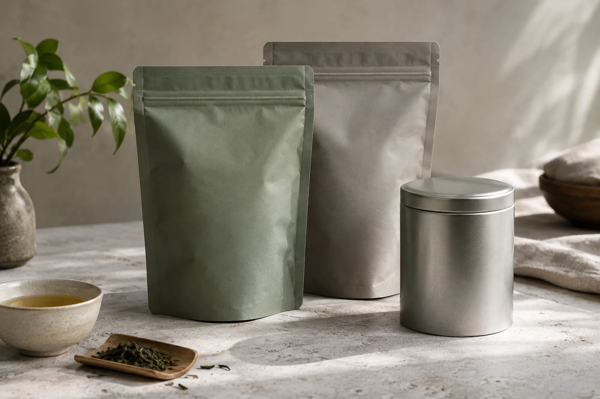

一到潮濕的月份，我開茶袋就特別慢。

袋口一鬆，香氣常常比葉片先到。天氣乾爽的時候，這一下是期待；空氣又濕又悶的日子，我會多一分留神，想先確定裏面的茶沒有受潮。所以水還在壺裏未滾，我已經倒了一小撮在茶荷上。

聞乾茶的做法很簡單：取少量茶葉，倒在清潔乾燥的茶荷或白碟上，靠近輕輕聞，記下香氣清不清楚、有沒有不尋常的雜味，再看看葉形和色澤。

把鼻子埋進茶袋，或者一口氣深吸，都不合適。靠近，輕聞，停一下再聞一次，通常第二次比較清楚。

## 三次聞香，三種東西

一款茶其實可以聞三次，每次聞到的不是同一件事。

第一次是乾茶的冷香，剛開袋那一刻，最貼近這批茶存放的狀態。第二次是熱香：溫杯之後把茶放進去，蓋上，等半分鐘。熱氣把揮發物推出來，藏着的東西這一刻才露。第三次是注水之後的濕香，茶葉展開，氣味最飽滿，也最接近你等會喝到的。

三次記錄下來，同一款茶的輪廓會厚很多。只聞開袋那一刻，你其實只認識了它最表面的一層。

有些人習慣用雙手把茶荷捧近，輕輕哈一口氣再聞，借手心和呼氣的暖意把香氣帶起來。有些老師會教這個方法，效果也確實明顯。不過這一步不是每次都要做，用自己舒服的方式就行。

說不出名稱，就描述感覺：偏清新還是偏溫暖，容易察覺還是很淡，令你想起木頭、果皮，還是熟悉的廚房氣味。這些生活經驗，比背誦一串自己從未聞過的香名可靠。

## 這幾種氣味，先別沖

聞到明顯的霉味、油耗味、焦糊味，或者夾雜着化學品似的刺鼻氣味，就先別泡，把茶放下，查看保存情況。茶葉受潮容易長霉，入口並不安全。

有些氣味其實無害。重焙火的茶有焙香，熟普洱有堆味，陳年茶有陳香，這些是茶類本身的特徵，不等於變壞。分辨時我會看三點：氣味是否令人不舒服，是否帶着霉或酸敗的感覺，與同類茶的常態是否相符。

也有一種情況是虛驚。新袋、新罐本身有氣味，茶剛換了包裝，頭幾天的香會悶住。我會把茶倒出來透一透，隔一晚再聞。氣味散了，茶就沒問題；仍在，就當它有問題處理。這種時候寧可錯殺。

## 乾茶的香，和茶湯的香

兩者未必一致。乾茶聞起來濃郁，茶湯未必同樣濃厚；乾茶內斂，入口也可能一層一層地開。注水之後再比較一次，把前後感受放在一起，比單憑開袋那一刻評價完整。

連續聞很多款，鼻子會疲倦，中間可以離開桌子，到外面呼吸一下。有人說聞咖啡豆可以清鼻，我試過，作用不大；離開一陣，讓鼻子重新安靜，反而更有效。

乾茶的第一印象，只代表這個時刻的這一份茶。茶葉開袋後放得久，或者和其他有氣味的東西放在一起，香氣都會改變。

茶容易吸收周圍的氣味，也怕潮、怕光。密封、避光、遠離廚房和香料，是基本做法。取茶之前，讓整包茶回到室溫再開封，免得冷的茶葉遇上空氣，凝出水氣。潮濕的日子，這一步尤其不能省。

同一款茶，新開袋時和開了幾個月之後香氣差得很遠，不一定是茶變差，也許是存放環境不同。留一份記錄，下次比較才有憑據。

鼻子是可以練的。聞得多，記得住，說得出，最後不必命名，也能分出這一款和那一款的距離。
