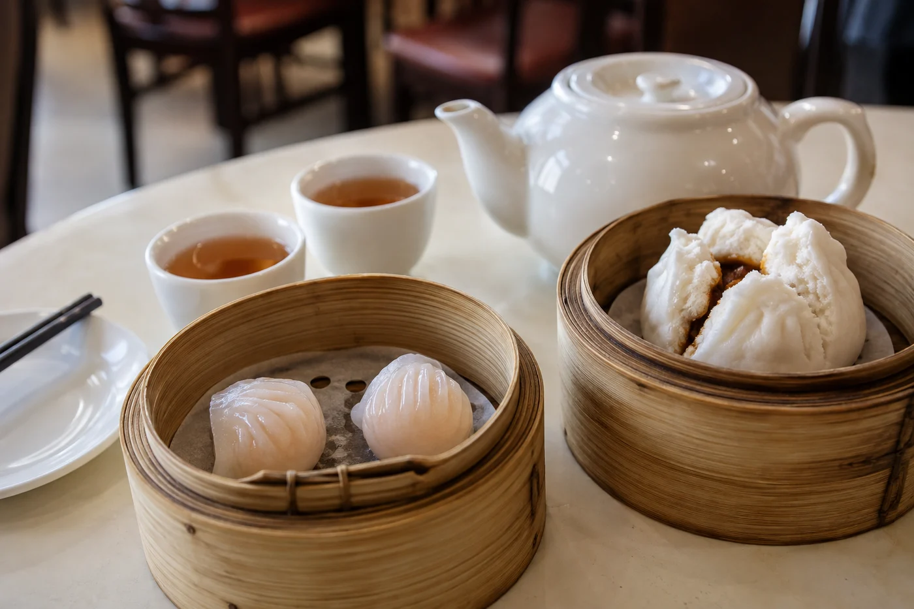

我指一指茶壺，再指一指對方，揚一揚眉。他笑着點頭。

那一刻，我們還沒說上一句完整的話，茶已經可以開始了。

我指一指杯：「Hot?」

他想了想，答：「Warm.」

和語言不太相通的人坐下喝茶，我會先放下一隻杯，問清楚對方想不想喝，喜歡熱的還是溫的。一句完整的介紹，未必馬上想得好，杯子卻可以先說話。

除了喝不喝，還要問有沒有要避開的東西：咖啡因、糖、奶，或者過敏。這些用簡單的詞加手勢就問得到，指一指，做個疑問的表情，大家都明白。有一次一位客人一直搖手，我以為他不想喝，後來才知道他剛做完手術，醫生囑咐少喝濃茶。那一杯我倒得太快，之後就養成了先問的習慣。

我也提醒自己別作假設。不是人人都喜歡同一種茶，自己熟悉的禮儀也不是到處通行的規矩。有人習慣加糖加奶，有人只喝清水，有人不慣燙口的飲料。尊重這些差別，比急着找共同點更令人安心。

## 看、聞、嘗，比翻譯有用

介紹茶，我用看、聞、嘗。拿一撮乾茶給對方看，遞過去讓他聞，再倒一杯請他嘗。三步做完，勝過幾句生硬的翻譯。器具也一樣，指着蓋碗做一次沖泡，對方自然看懂它怎樣用。倒水的時候慢一點，讓他看見水從蓋與碗之間那道縫走出來，比解釋十句「這是蓋碗」清楚。

真要寫字，就用短句和單詞：茶的種類，熱或冷，苦或甜。手機翻譯可以應急，但專有名詞常常譯得不準，茶類名稱尤其如此。我習慣同時寫上原名，再附一句簡單的描述，讓對方自己回去查。

茶名、地名要翻譯，先查清楚才說。「茶」在各地的叫法不同，不少語言的讀音接近「cha」，也有不少接近「te」。一般的說法是，這和茶葉傳播的路線、來源地的方言有關：走陸路北上的多帶「cha」的音，經海路出口的，多數保留了閩南語那一系的讀音。英文的 tea、法文的 thé 屬後者，波斯語、俄語、土耳其語的 chai 屬前者。日文的「茶」，寫法與我們相同，讀音也屬「cha」一系。這類話題很引人入勝，但每一條路線的細節都有爭議，不要因為某個語源故事好聽，就當成確定的歷史。講的時候加一句「一般認為」，比講得斬釘截鐵穩妥。

形容滋味可以很直接：香、淡、濃、暖、甜、苦。對方也許會說，像家鄉的某種水果，某種花。我不急着糾正，由他說，我只管記下來。有位在英國教書的朋友，第一次喝鳳凰單叢，說像小時候吃過的一種果醬。我沒聽過那種果醬，但那一句比「蜜蘭香」更能說明他喝到甚麼。

聽不明白的地方，慢慢問。杯子可以續，話也有時間找到路。

## 幾處容易失禮的小地方

對方喝得少，或者索性不喝，別當成他失禮，也不要反覆勸。

各地斟茶、敬茶的習慣不同。在我們桌上很自然的動作，在別人眼中可能另有意思。主人簡單說一句「這是我們的習慣」，然後讓對方按自己的方式來，就好。有些地方倒茶要倒滿，有些地方只倒七分；有些地方先敬客人，有些地方先敬長輩。誰對誰錯都談不上，只是不同。

茶很燙的時候，要提醒一聲。指一指杯，再做一個吹氣的動作，就夠了。

如果真的一個字都聽不懂，那就安靜地一起喝。茶桌上的靜默不一定尷尬，很多時是舒服的。續茶、遞杯、點頭微笑，這些動作不用翻譯。想多走一步，可以留一張寫着茶名的小紙條，或者分一小份茶讓對方帶走，回去慢慢喝。

有外地朋友要來，我會先備好兩三款清淡的茶，另加一壺白開水，讓對方自己揀。茶壺不換，杯子換大一點，倒得少一點，坐得久一點。
