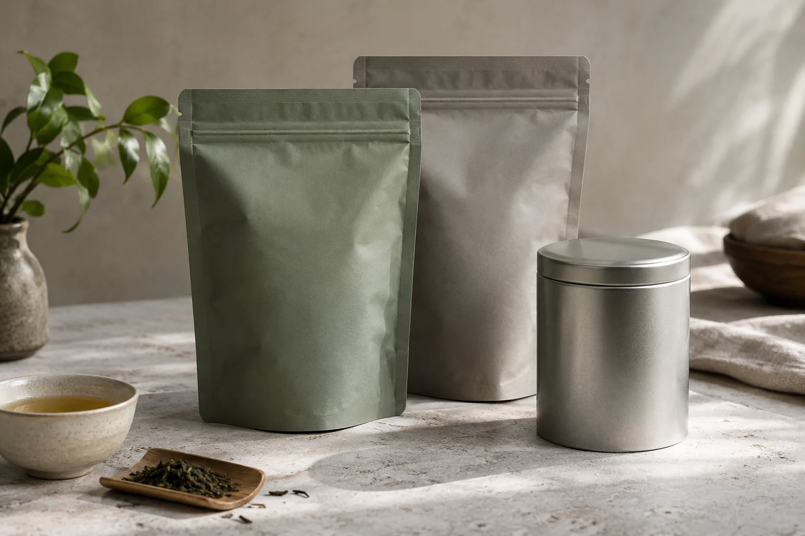
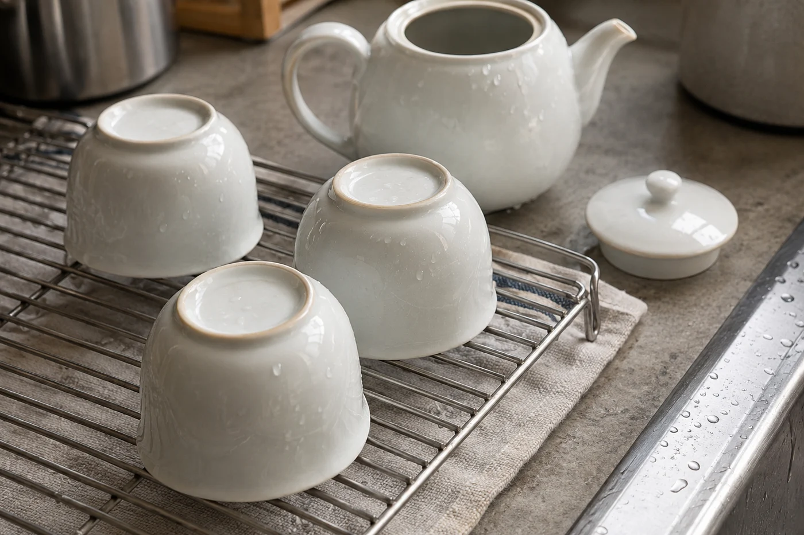

打開一袋清香烏龍，迎面先來的，是一陣咖喱粉的味道。

這種事很常見。茶、咖啡、八角、咖喱粉排在同一層架上，取用確實方便。可是茶的香氣細緻，鄰居的氣味太豐富，下次開袋，聞到的是茶香還是別的，連自己也說不準。

茶葉很容易吸收周圍的氣味和濕氣，所以我不贊成把它放在廚房的調味架上。

廚房裏不只有調味料，還有煮食的蒸氣、油煙，和起伏不定的溫度。蒸氣帶來水氣，油煙帶來油味，爐頭附近的熱又讓茶容易走味。架子看起來整齊，未必適合茶。

就算茶是密封的，每開一次袋取茶，空氣就進出一次。在廚房開袋，進去的就是帶着煮食味道的空氣。

香氣淡雅的茶最吃虧。綠茶、白茶、清香型烏龍放在廚房，幾個星期就會覺得香氣變鈍。重焙的茶、陳放的普洱看來比較「皮實」，其實同樣會吸味，只是變得慢，不易察覺。

我見得最多的，是茶放在電飯煲、水壺旁邊。伸手就拿到，卻把一天幾次的蒸氣都吸了進去。方便和穩妥之間，我寧願多走幾步。

我較推薦客廳或書房裏一個乾爽、不被日光直射的小櫃。用之前先清潔，確認櫃裏沒有清潔劑或木器塗料的濃味。新家具有時氣味很重，先放一陣子散味再用。不同的茶，按包裝上的建議保存，別因為櫃子好看就忽略了實際環境。

也有人說，自己的廚房很大，有獨立的櫃，應該沒問題吧。要看實際情況。櫃子靠近爐頭、水槽，或者家裏經常煮食，蒸氣和油煙仍會鑽進去；表面乾淨，櫃內的空氣也可能帶着飯菜味。

有個簡單的試法：打開櫃門，湊近聞一聞，有沒有不屬於茶的氣味。有的話，這個位置就不太適合。

家裏真的沒有別的地方，就將就一點。選離爐頭、水槽最遠的櫃，茶用密封袋或有蓋的罐裝好，再放進一個有蓋的盒子，多一層屏障。不要和咖啡、香料、乾貨、蚊香、清潔用品放在同一格。

茶具洗完要抹乾、晾乾才收，不要濕着放進櫃裏。茶具櫃與茶葉櫃分開，最理想。

杯子和香料罐靠得太近，或者手剛塗過香水、精油就去拿茶，都會影響品飲。洗杯用的清潔劑，要用清水多沖幾次，免得杯裏留着洗潔精的味道。想認真比較幾款茶時，把周遭的氣味減到最簡單，茶的輪廓才看得清楚。

取水、燒水仍然可以在廚房，茶葉不必跟着進去。我會先從櫃裏取出一次的分量，放在茶荷或小碟，再去燒水，水好了回到茶桌沖泡，茶袋隨即封好放回原位。這樣，茶葉在廚房逗留的時間只有幾分鐘。

茶在家裏用不着很大的地方，一個合適的角落就夠。地方對了，茶自然放得久，打開袋的時候，也還是當初那個氣味。
