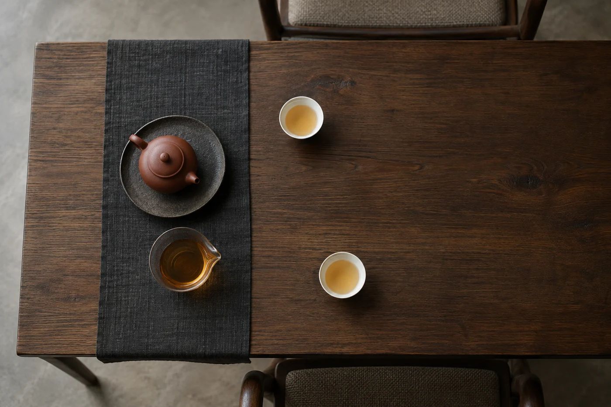
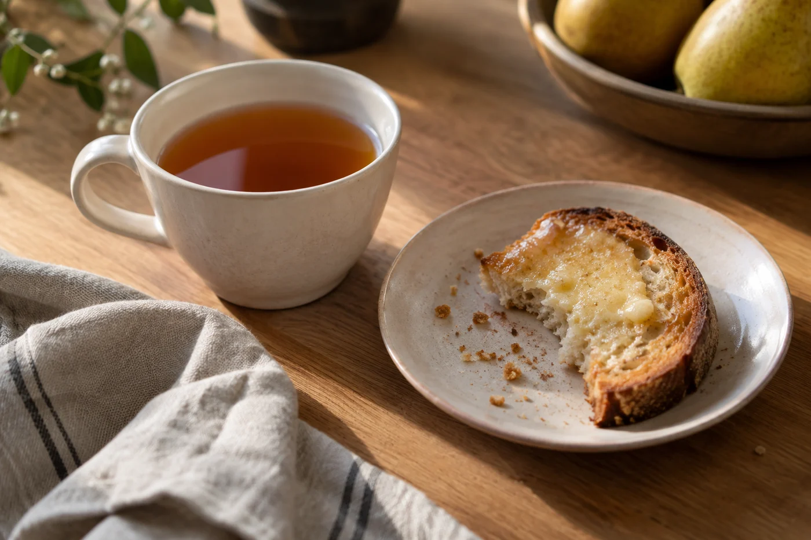

有人帶來一盒酥餅，盒蓋一打開，桌邊的話就多了。

桌上多一碟點心，氣氛往往親切起來，這點我很喜歡。不過遇上要認真比幾款茶的一桌，我會笑着把盒子先蓋上，說喝完再吃。

茶點怎樣安排，我會先看這次相聚想做甚麼。閒談為主，就按大家口味準備，分量小些，方便拿。要認真比較幾款茶，就先喝茶，品完再上點心，免得甜味和油味留在口裏。有人愛酥餅，有人喜歡果乾，我不覺得要照着某張「最佳配搭」清單來。

點心切成小塊，一口能吃，不會弄髒手，也不會逼客人一手拿碟、一手捧熱杯。

成分和常見的致敏原，例如花生、堅果、乳製品，要告訴客人，讓他們自己決定吃不吃。某種食物對身體有甚麼好處，說多了就變推銷，茶點只是陪伴。

港式茶樓又是另一回事。一盅兩件，茶和食物同時上桌，邊吃邊聊，用不着分先後。茶的作用本來就是配食物、解膩，各人喝得濃淡，計較不來。

## 甜的先吃，茶就苦

試過一次中秋前的茶聚。有人切了一角月餅，大家吃着說笑，之後再泡一款平日覺得柔和的烏龍。第一口下去，幾個人同時皺眉，說這茶怎麼苦了。

茶沒有變。糖留在舌上，再喝任何帶苦的東西，苦都會被放大；油和奶蓋在口腔，茶的細緻也進不來。那一晚我們把餅收起來，用清水漱過口，再泡一泡，同一款茶又回到原來的樣子。

「今天這茶怎麼苦了？」

「先漱漱口。餅收了，再泡一次。」

所以要比茶，口腔要先乾淨。濃味、甜味、香料都可能留在舌上，左右後面的判斷。時間長，中途想吃點東西，就揀味道淡的，例如無糖餅乾、清淡的米餅，吃完先喝一口清水，再繼續。巧克力、辣味堅果、濃烈的芝士，留到最後。

甚麼茶配甚麼點心，沒有定律。常見的做法是讓兩者互相平衡。茶味重的，例如熟普洱或濃的紅茶，配奶香、油脂多一點的點心，口裏比較舒服。清淡的綠茶、白茶，配素淨些的，例如水果、淡味糕點，免得蓋過茶味。這些只是習慣，客人喜歡甚麼，就配甚麼。

點心離熱水區遠一點，夾點心的工具和茶具分開，碎屑隨手清理。桌面留些空位，客人鬆下來，才聽得進別人說話。

碟子用小碟或小紙墊都可以，每人一份，免得大家互相伸手。顏色盡量素淨，別搶了茶具的位置。

衛生也要想到。點心用有蓋的容器放着，夏天不要放太久。易變質的奶油蛋糕、鮮果蛋糕，吃之前才拿出來。茶席上的手要乾淨，夾子和碟分得清楚，每人一雙筷子或一把小叉。

## 客人有不吃的東西

事前問一句「有沒有不吃的」，比在桌邊尷尬好得多。常見的有素食、清真，或者對花生、乳製品敏感。我會準備幾樣不含這些成分的，另放一碟，在碟旁註明。

成分不清楚，寧可不上這道點心。這和茶無關，是待客的基本責任。

點心和茶配得是否天衣無縫，我不太計較。讓人吃得方便，知道自己吃的是甚麼，待客的本意就到了。一碟點心旁邊放一張小卡片，寫上名稱和主要成分，這點工夫比配搭更實在。
