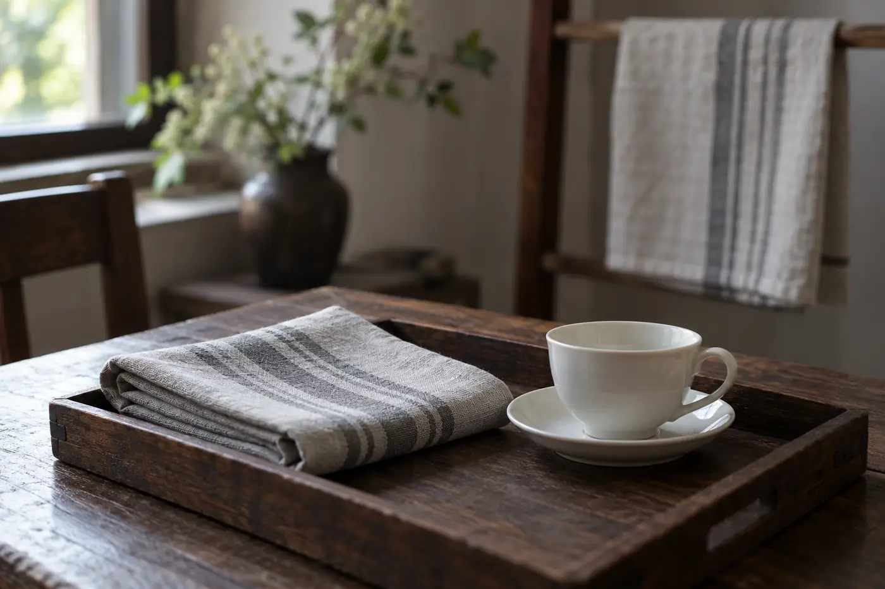

天氣一潮，茶巾就最先露出破綻。前一晚收席時順手摺好，放進抽屜，第二天拿出來，還帶着濕氣，湊近一聞，有點悶。

那塊布本身沒有問題，問題出在收的方法。茶巾天天貼近杯和壺，它乾不乾淨、有沒有氣味，會一路傳到器具上。

茶巾的工作很簡單：吸掉杯底、壺身和桌面的水滴。要求也不多，專布專用，選吸水、易洗、不掉絮的布，濕了就換，用完洗淨晾乾。其餘的細節，都排在這幾樣後面。

同學看見我換布，問：「紙巾不行嗎？」

「擦一次就丟。水滴多的時候，不夠用。」

擦茶具的茶巾，不要拿去抹地、擦垃圾，或處理其他髒東西。要大面積清潔桌面，另外備一塊。茶席上的東西界線清楚，用的人安心，喝茶的人也安心。

專用還關乎氣味。混用的布容易染上廚房油煙或清潔劑的味道，擦過杯底，味道沾到器具上，最後落到茶香裏。

## 揀布

純棉、麻、棉麻混紡都是常見選擇，吸水力不錯。太厚的不易乾，太薄的又吸不夠，中等厚度最實用。

新買的布先按說明洗一遍，才放上茶席。深色不顯茶漬，淺色一髒就看得見，要多洗，卻也提醒你甚麼時候該換。

有一件事很多人不知道：洗布的時候不要加柔順劑。柔順劑在纖維表面留下一層膜，摸起來軟，吸水卻差了。布擦不乾水，就等於把水從壺底搬到桌面。同一道理，洗衣液用少量就夠，泡沫沖不淨，下一次擦杯底，那點味道就跟着上杯。

「加一點柔順劑，不是更軟嗎？」同學摸着剛買的布。

「軟是軟。水吸不進去。」

## 擦哪裏，不擦哪裏

主要擦三處：壺或蓋碗倒完水之後底部的水，免得滴到桌面或杯上；杯底和杯托的水，客人接杯時不會滴到衣服；還有桌面的滴痕。

杯口和杯內，不用茶巾去擦。嘴唇碰的地方要保持乾淨，杯內的水，倒掉或晾乾更穩妥。

泡到中途，茶巾濕透了，就攤開晾一晾，或者換一塊，不要一層層摺起來繼續用。吸滿水的布擦不乾東西，只是把水從一處搬到另一處。我習慣備兩塊輪流用，一塊在手，一塊晾着。

一個人沖泡，一塊就夠。有客人，或者連泡好幾輪，我會多備一兩塊，分開用途：一塊擦壺和蓋碗，一塊擦桌面，一塊擦杯底。這樣每塊布髒的程度不同，桌面的茶漬也不會帶到杯底。旁邊再放一塊乾淨的備用，杯翻倒、茶濺出，伸手就有。

## 收拾

結束後即時洗，充分晾乾。長期濕着的布，外表看不出問題，也不適合一直貼近茶具。茶漬先用清水搓，再用溫和的清潔劑洗淨，沖到沒有泡沫為止。

晾的時候攤開，掛在通風的地方，完全乾透才收，不要摺着放進抽屜。開頭那塊布，就是少了這一步。若已經有霉點或異味，直接換掉，不必捨不得。

茶席整潔，不在於一滴水也沒有。水滴出來，順手擦掉，布放回原處，下一杯仍然有個乾爽的位置。
