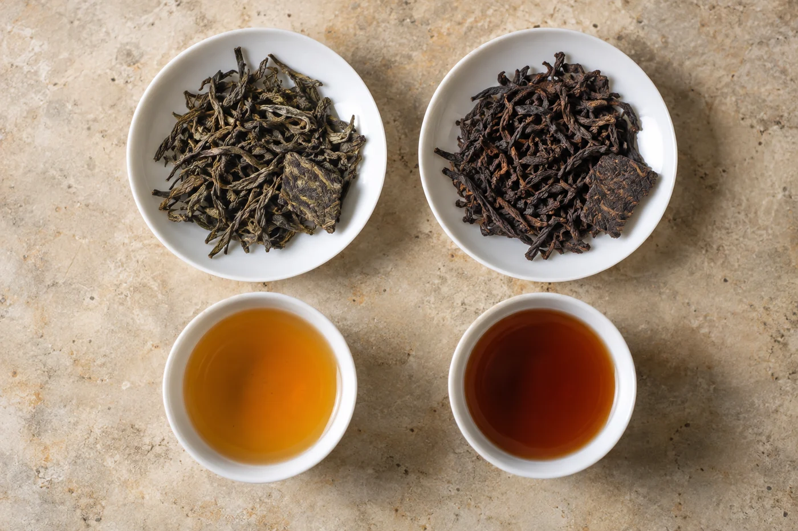
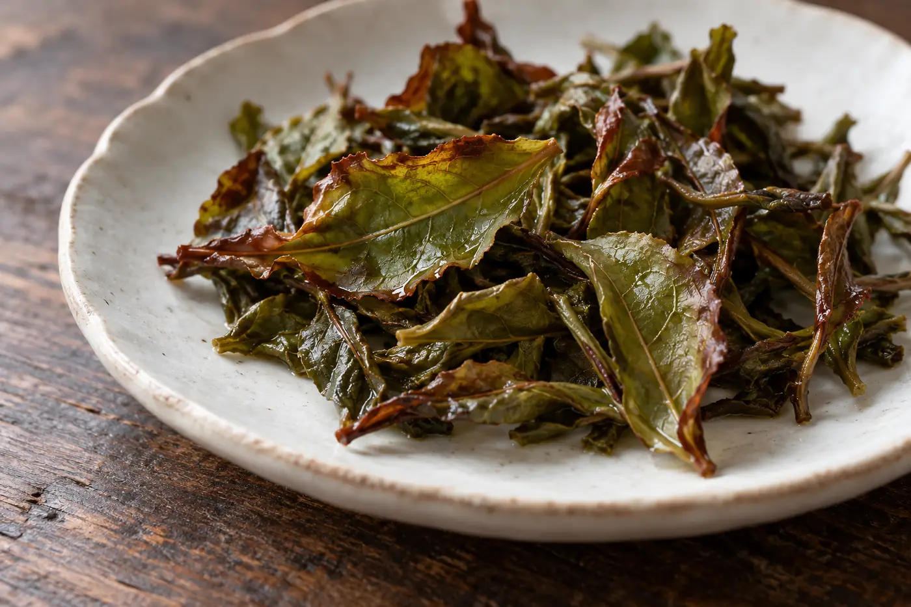

初學茶的時候，我也以為茶裏說的「發酵」，和釀酒、造豉油是同一件事。聽到紅茶是全發酵、熟普也是發酵，就把兩者放在同一條線上，一個比一個重。

後來跟着製程一步步看，才知道這個詞底下有兩種過程。紅茶、烏龍茶製作中的發酵，主要是鮮葉內的多酚類在酵素作用下氧化，與酒和豉油那種由微生物主導的發酵不同。普洱熟茶的渥堆，才有微生物參與。

這個分別聽來學術，用處卻很實際。課堂上許多疑問，都由這一個詞而起。

「紅茶和熟普，哪個發酵得重？」

「兩條不同的路。紅茶是氧化，熟普靠微生物。」

葉子從枝上摘下來，細胞裏的酵素仍然活着。葉片失水，受到搖動或揉捻，細胞壁受損，酵素和多酚類碰在一起，就會氧化。顏色由綠轉黃、轉紅、轉褐，香氣也隨着改變。切開的蘋果放一會就變色，是同一類事。

製茶人要決定的，是讓這個過程走到哪裏，在哪個時間停。綠茶一開始就殺青，用高溫令酵素失去活性，氧化幾乎停在原點。殺青時鍋溫往往在兩百度上下，葉子下鍋要聽見輕輕的一聲，師傅憑聲音和手上的感覺判斷夠不夠。烏龍茶讓葉片氧化到一部分，再以殺青定住，所以輕重差別很大。紅茶讓氧化走得很足，才進入乾燥。

氧化不是一條平滑的線。開始時酵素活動最快，葉片由青轉黃的那段時間最難拿捏，天氣一潮，或者堆得太厚，溫度升得快，轉眼就過了頭。所以做紅茶和烏龍的人，整夜守在旁邊翻葉，不是為了好看。

所謂「發酵幾成」，只是方便的說法，表示氧化的大概程度。不同茶區、不同品種，做法都有差異，這個數字很難精確，也不宜當成通用標準。

氧化之後，味道跟着轉。葉內原本較苦澀的成分逐步轉成別的物質，茶湯顏色變深，澀感通常減輕，口感趨向圓厚，香氣由青草氣、花香，轉向果香、蜜香。一般認為，紅茶發酵時多酚類會聚合成較大的分子，一部分成為令湯色橙紅、滋味較爽的物質，再走下去，又變成顏色更深、口感更厚的一類。這條路走得太遠，香氣會遲鈍，走得太近，湯色又薄。做茶的中間那一段最值錢。

這只是一般的趨勢，並非每款茶都這樣，品種和後來的焙火都會改變結果。輕氧化的茶多帶清新鮮爽，氧化較足的多有醇厚的口感。哪一種好，是口味的事，我不分高下。

## 渥堆走的是另一條路

熟普洱的做法，是把曬青毛茶堆起來，加水、保溫、翻堆，讓微生物在濕熱環境中作用，加速茶葉的轉化。這一步叫渥堆，屬於後發酵，和紅茶的酶促氧化性質不同。

兩者都叫「發酵」，只是習慣用語。我從前那樣把紅茶和熟普洱放在同一條由輕到重的線上比較，正是最容易誤導初學者的地方。

還有一種常被叫作發酵的變化，是生普洱陳放多年的轉變。那是存放過程中的緩慢轉化，機制又與渥堆不同。要分清楚，可以先問一句：這是製作時的一道工序，還是存放時間造成的變化？

## 烏龍最難一句講完

烏龍茶的氧化程度，輕的只有一成上下，重的超過一半，各產區、各風格差距很大。有人聽到「半發酵」，便以為所有烏龍都剛好落在綠茶與紅茶的中間，事實並非如此。

焙火會改變茶的顏色與香氣，但那是另一道工序，與氧化是兩件事。一款焙得較深的輕氧化烏龍，外表可能比氧化較重、卻沒有焙火的茶更深。顏色、氧化、焙火混在一起談，自然說不清。所以我常勸初學者，把「氧化」「渥堆」「焙火」分開記。

買茶時看到「重發酵」「輕發酵」，可以當作一個大概方向，不當精確指標。輕發酵多指保留較多清新的特質，重發酵多指口感較醇厚。可是各家的用詞標準不同，同一個說法在不同店舖可能代表不同程度，最好再問一句製作上有甚麼特點，或者直接試飲。

遇到「發酵」二字，換幾個問題去問更好：這道工序發生了甚麼變化，由誰、用甚麼方法控制，接着做的又是甚麼。問得具體，對方才有東西可答，你也較易分辨他說的是氧化還是渥堆。

不同書籍和茶人，用詞也未必一致。看到分歧，不必急着判斷誰對誰錯，先看對方怎樣定義，再對照製程。

化學名稱不用一次背熟。把鮮葉在甚麼條件下被怎樣處理弄清楚，再配着茶樣去喝，慢慢就紮實了。我教這一課，最後只留一句給學生：看顏色之前，先問它經過哪一步。
