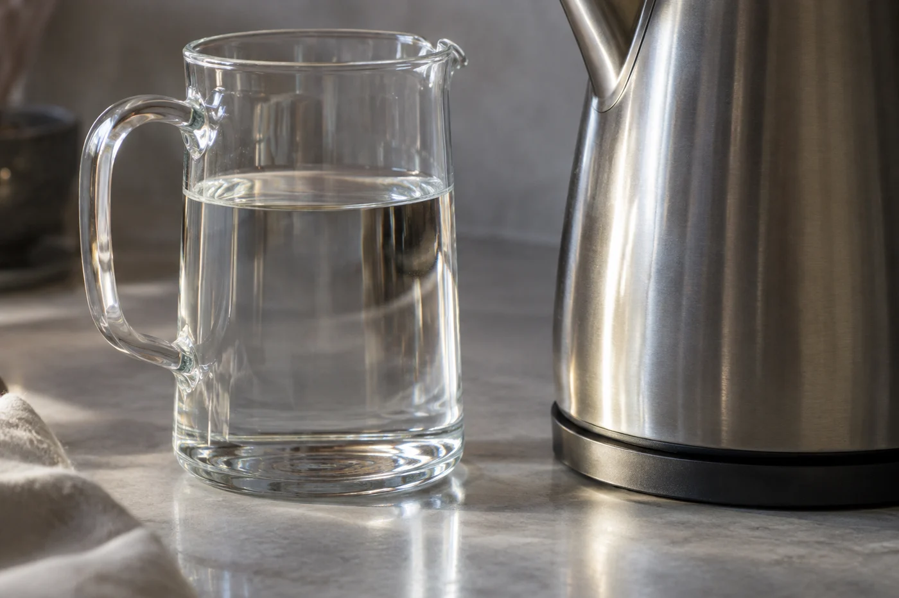
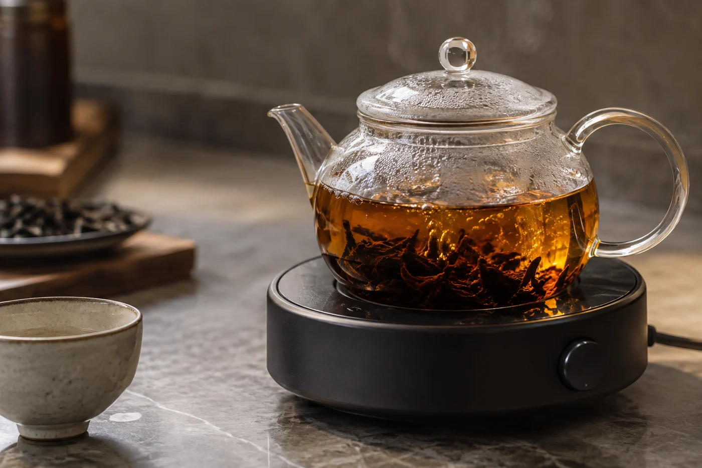

天一冷，我燙杯的次數就多了。

不是為了儀式。冬天課室那幾隻玻璃杯，放在窗邊一個上午，摸上去和自來水一樣。水滾了直接注進去，熱先被杯子吃掉一大截，到茶葉那裏，已經不是你想像的溫度。

上個月一位同學不信。同一壺水，同一個蓋碗，他先泡一次，覺得淡；再泡第二次，卻覺得剛好。差別只在第一次的蓋碗是冷的。我把溫度計插進去，一次八十幾度，一次七十四度。十度上下，他沒想過會發生在兩分鐘之內。

水一離開水壺就開始降溫，這是物理，不是手勢。器物的厚薄、室溫、注水快慢，每一項都在偷走幾度。玻璃和薄瓷吸熱快，紫砂更甚，寒天尤甚。所以有人泡茶前先用熱水把器具燙一遍，說穿了，是補回那十度。

## 為甚麼十度會差那麼遠

茶葉裏的東西，溶出的速度不一樣。

香氣物質最輕，一遇熱就散出來，所以高溫沖下去的頭幾秒，味道最衝。苦澀也跟着快，水越熱，出得越猛。低溫慢一些，溫柔一些，可是有些香，溫度不夠就是出不來，等多久都等不到。

這就帶出一件事：時間補得回濃度，補不回香氣。

水涼了，把浸泡時間拉長，湯色可以追回來，舌頭上的份量也可以補。可是那一層浮在杯口的香，錯過了就是錯過了。所以我常說，泡茶先定水溫，再定時間，次序倒過來做，永遠在追。

## 表是起點

說到水溫，很多人想要一張表，背熟了安心。我從來不給。

嫩一點的綠茶、黃茶、白毫銀針，八十度上下；葉片成熟的綠茶可以再高些。烏龍、紅茶，九十度以上到接近沸騰。普洱、老白茶、岩茶，多數直接用沸水，讓緊壓的葉子舒展，也把香氣逼出來。

這些度數講的是水碰到茶葉那一刻，不是壺裏剛滾那一刻。八十度的水倒進冷杯，到手可能只剩七十度出頭，泡出來寡淡，你會以為茶不好。

茶量、時間、水溫三者相連。茶放得多，水涼一點也泡得出濃度；茶放得少，用熱水反而剛剛好。所以照包裝上的建議泡第一次，喝完再微調。表上的數字是起點，不是答案。

## 兩杯並排

想知道自己站哪一邊，親手比一次最快。兩份相同茶樣，兩套相同器具，一份用剛滾的水，一份等水稍涼才注。兩杯都放到不燙口，先聞，再喝，逐項比。

用烏龍或綠茶最好，它們對水溫的反應明顯。喝完記一兩句：「高溫香大，尾段有點澀；低溫柔，香薄。」比三四次，心裏就有數。

沒有溫度計也不要緊。把滾水先倒進公道杯，再倒到茶葉上；每倒一次降幾度，倒兩次就比剛滾低一截。旅行到高原又另一回事，那裏沸點本來不到一百度，同樣叫剛滾，溫度已經不同。

有些老茶、緊壓茶放在爐上持續加熱，水一直接近沸騰，那是另一種喝法。鍋裏煮出來的厚，和蓋碗沖出來的清，是兩件事。

回到杯子上。茶喝起來清楚順口，就不必為了符合誰的說法去否定它。苦了，把水降一點；淡了，升一點。手摸一摸杯壁，熱得燙手，就先等。泡得多了，那幾度會自己長在手上。
