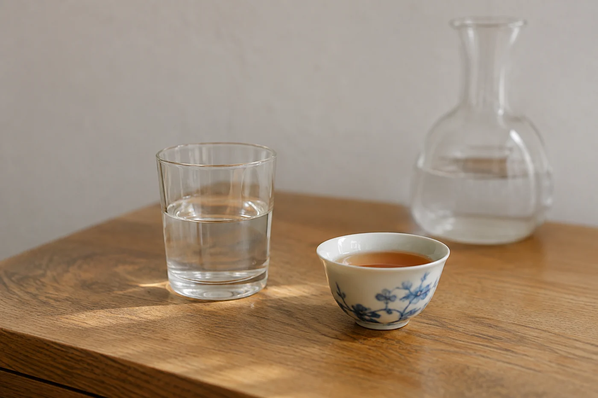

我以前出門，總想把茶席整套帶走。多一隻杯，多一塊茶盤，再塞一個小壺，行李箱快要合不上。

到了旅館，桌子只有那麼小，最後用的還是最簡單的那幾件。其餘的一路跟着我上車下車，沒有拆開過。

現在我收拾旅行茶具，只看輕不輕、好不好洗、能不能晾乾。數量按實際會用的人數定，一般兩三件便夠。多帶的，到頭來多半只是行李裏的負擔。

一個人出差，一隻附濾網的杯，或者一套小型便攜組合，可能就足夠。和朋友同行，再多帶幾隻杯。把家裏整張茶桌搬出門，既重且無謂。

揀容易清洗的款式，易碎的部位另外保護。蓋碗之類的瓷器，用軟布包好，或放進收納盒，不要和硬物相碰。

材質各有長短。瓷器最好喝，也最易碎。玻璃透明好看，同樣怕碰，但輕一些。不鏽鋼和其他耐摔的材質不怕撞，缺點是看不到湯色，有些人覺得口感也差一點，這是個人感受，沒有定論。

行程若是爬山、露營，或者行李會被拋來拋去，選不易破的比較穩妥。城市酒店短住，帶一個小蓋碗和兩隻杯，包好放在行李中間，一般都能平安抵達。

## 帶經得起將就的茶

旅途上的水溫和時間，很難像在家那樣準。所以我帶耐泡、不易受潮、對水溫沒有太苛刻要求的茶。烏龍、紅茶、熟普洱，還有一般的老茶，多半經得起這種不太精準。細嫩的綠茶對水溫敏感，酒店的水一滾就倒進去，很容易泡得苦。旅行時我多數不帶它。

量要帶得剛好，比預計天數多帶一兩泡就夠。帶一大包出門，既佔位置，也多了受潮的機會。

茶葉出發前就分成一泡一泡的小份，標上名稱，到時候取一包就用，省去現場找秤。每份都密封好，避免受潮和串味。不同的茶最好分開裝，香氣濃的尤其不要和清淡的放在同一個袋裏。裝茶的容器要乾淨乾燥，也不要在潮濕的環境裏打開。

## 水的事先弄清楚

到了陌生的地方，先確認有沒有可以飲用的水，有沒有加熱的設備。酒店房間常備的電熱水壺，用之前先看看清潔是否可以，不放心就多煮兩次，倒掉頭一壺再用。條件不合適，就留待下一站，勉強走完一整套程序反而累人。

自備水的話，水量宜少，夠泡一兩泡就好。用熱水瓶裝熱水乘車或乘機，要符合交通工具的規定，這方面出發前自己查清楚。

用完，熱水倒掉，器具放涼、洗淨、晾乾，才放回袋裏。熱的或濕的東西和衣物放在一起，容易發霉，也容易把異味帶進行李。趕着退房的早晨，這一點比器物好不好看實用得多。

晾乾的位置，在旅館裏可以是浴室毛巾架旁、窗台，或者桌面一角鋪一塊乾毛巾。我會在出發前一晚就洗好，早上出門便從容一些。

旅行時的一杯茶，跟家裏那杯本來就不會一樣。窗外換了景色，桌上少了幾件東西，熟悉的滋味仍然可以陪你坐一會。帶得輕，才真的用得上。
