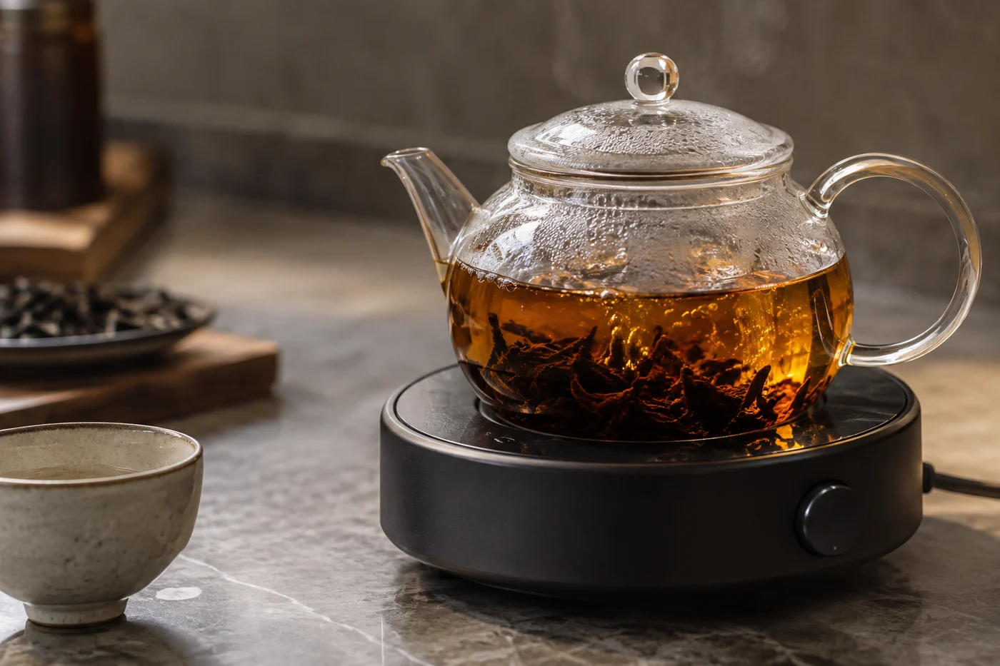

朋友說要過來坐一會。我燒了一壺水，取出兩隻杯，茶罐只開了一個。

旁邊還有一款放着，未拆。等他到了，看時間和興致，再決定開不開。

他坐下，看了看桌面。

「只開一罐？」

「先喝這個。想換，再拆。」

我也見過另一種主人。朋友本來只想喝杯茶，主人卻不知不覺備了六款茶、三種杯，外加一整套講解。桌子還沒熱鬧起來，主人已經忙得像在辦活動。

茶備多了，人就分心。水夠不夠熱，杯夠不夠暖，每一泡都得盯着，對方說的話便聽不進去。

## 兩個人的難處

兩個人喝茶，其實比分一桌人更難。

「你講先。」朋友見我提着蓋碗。

「不用。茶等得。」

人多，大家可以自己講話，你低一次頭出湯，沒有人會停下來等你。兩個人，對方正說到要緊處，你手裏那一泡剛好到了時間。出湯，打斷他；不出湯，茶就濃了。很多人都遇過這種兩難，只是不好意思說。

我的做法是揀耐得住一點的茶。熟普、焙火的烏龍，多浸十秒不至於難喝，給了你聽完那句話的餘地。清香的綠茶、白茶留給安靜的時刻，或者留給自己一個人喝。

另一個辦法是把壺放低。用蓋碗，出水要提起手腕，動作大；用小壺，手不用抬，倒完可以立刻放下，眼神不必離開對方。兩個人說話的茶席，我常用壺，雖然洗起來多一件。

## 一桌兩人的份量

一個蓋碗或一把小壺、兩隻杯、一個公道杯，已經足夠。約百毫升的蓋碗，放三到五克茶葉，是普遍的起點，按茶類增減：烏龍、普洱多一點，綠茶、白茶少一點，以包裝上的建議為準。泡四五輪，兩人各喝兩三杯，就是合適的長度。

煮水的位置離座位近一些，省得常常起身；茶巾放在手邊，濺了水也不慌。熱水壺在兩個人的桌上特別佔位，我會放在自己身後的小几或側邊，倒水時才轉身。

茶太多，容易泡得濃而苦；太少，喝着沒味道。第一次照平日的量，再看對方的反應調。

朋友晚到幾分鐘，話題忽然走遠，都不要緊。茶湯濃了，下一泡快一點出，味道就拉得回來。水涼了，重新燒便是，茶葉不必急着換。

常來的朋友，我會讓他試泡一次。用熟悉的器具，先說清楚哪裏燙手，其餘讓他自己摸。分享一款茶，也包括把自己手上的位置讓出來。

茶點簡單就好。一小碟果乾或餅乾已經足夠。太豐盛的點心會把重心從茶和人身上移走，主人也得不停張羅。

## 第二款，等時機

時間充裕，對方也有興趣，才開。我通常揀風格相近、又有明顯分別的，先清淡，再稍濃，兩款之間隔一杯清水。對方已有倦意，或者話題正投契，第二款就不開了，留給下次。

兩個人喝茶，最好的分量是喝完還想再泡一泡，而不是剩下半壺倒掉。

他走的時候，我把兩隻杯收進櫃裏，茶罐蓋好，桌上只剩一塊茶巾。
