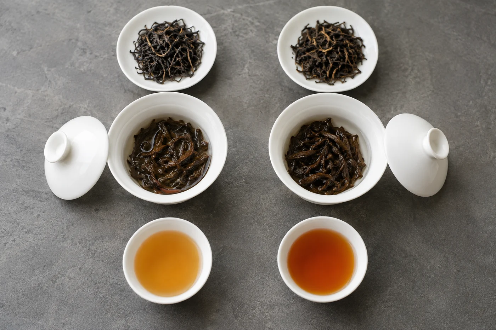

「這麼深色，火一定很重吧。」

乾茶一倒進茶荷，常有人先下這個判斷。我明白這種直覺，顏色是最先看見的東西。不過我會請他先別急，聞過、喝過再說。

焙火，是用熱力把茶葉慢慢烘乾，同時改變它的香氣和口感。烏龍茶、部分紅茶和黑茶的製作，常有這一步。火輕，香氣清揚；火重，多了穀物、堅果、焦糖一類的暖香，口感也厚些。

所有茶最後都要乾燥，把水分降到適合存放的程度，這是基本的一步。焙火在這之上，用更長的時間或更高的溫度去烘，為的是改變風味，不只是除水。有些茶乾燥完便是成品，有些要再焙一次、兩次，甚至多次。

熱源也有分別，有的用炭火，有的用電焙，各有講究。炭焙的香氣常被形容得溫潤些，這是風格取向，不代表炭焙一定勝過電焙。要看工序控制得好不好。

## 顏色會騙人

茶葉的氧化程度、品種和存放時間，都會令外觀變深。一款氧化較足的茶，乾茶已經偏褐，卻未必重焙過；反過來，有些茶外表不太深，火氣卻不輕。

比較可靠的，是同時看香氣、湯感和餘韻，再向製作者或賣茶的人問問火候大概屬甚麼風格。對方說得出「中火」「輕焙」「有重焙過再養過」這類話，已經比一個顏色有用得多。

## 焙香、火氣、焦味

好的焙香，氣息溫暖、乾淨，慢慢散開，茶湯仍然協調。

火氣不一樣，多見於剛焙好的茶，入口偏燥，喉間略乾，通常要靜置一段時間讓它退一退。若喝到焦味，苦澀突出，蓋過了茶本身的味道，那就不能當作焙香來欣賞了。

我自己習慣問一句：焙香底下，還喝得到別的嗎？香氣有沒有被壓住？甜味和花果氣呢？若全部被蓋掉，只剩一個「火」字，我會留意這款茶是不是做過了頭。

新焙的茶，火氣往往比較衝，喝下去喉嚨偏乾。許多製茶人和茶商會讓茶靜置一段時間，等火氣慢慢退去，味道才圓潤。有些茶還會隔一段時間再焙一次，這是傳統做法之一。

所以同一款茶，新舊之間口感可以相差不少。新買的茶喝來覺得燥，我會先放一陣，再向賣家請教保存方式。先別急着判定這款茶不好，或者自己不喜歡焙火茶。

養茶的地方要乾燥、無異味、避光，容器密封，不讓它吸濕。濕氣一進去，再好的焙香也會變質。

## 泡的時候

焙火茶一般耐高水溫，也耐泡，水溫夠高，厚度和香氣才出得來。

若覺得火氣明顯，我會這樣處理：第一泡快出湯，把表面的火氣沖走，之後幾泡再按口味延長時間。茶量也別放太多，新焙的茶尤其如此，一多就放大了燥和苦。按我的經驗，用稍小的容器、減少茶量，比單靠降低水溫見效。

要找自己喜歡的火候，方法不複雜。揀兩三款資料交代清楚的茶，用接近的茶量、水溫和時間沖泡，比着喝。有人愛溫暖的焙香，下雨天尤其想喝；有人四季都偏愛清爽，那就不必勉強自己去追重火。

焙茶用幾多度，問了也答不到一個準數。焙火牽涉時間、茶葉厚薄、含水量、焙的次數，一個數字說明不了全部。我多數是問製作者大概屬甚麼風格、建議怎樣喝。

選茶時，與其只說「輕火」或「重火」，不如把喜歡的說清楚，例如「想要帶點炭焙香，但不要燥」。這樣說，更容易買到合口味的茶。
