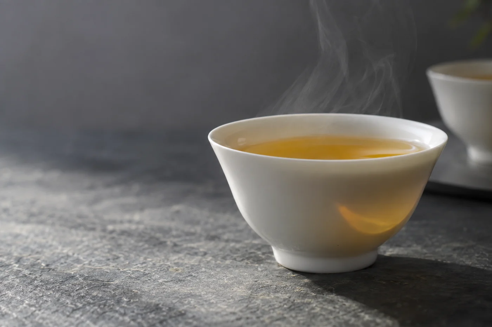

以前我坐下來，第一件事是開茶聞香。水燒好就沖，水本身是甚麼味道，從沒先嚐過。

後來有一陣子，同一款茶總覺得悶。香透不出來，湯色也暗。我以為是茶受潮，換了一餅；又以為是水溫不夠，改用滾水直沖。加多一點茶，只是更濃，那股悶沒有走。

最後才發現，是煮水壺。壺蓋裏那圈膠邊積了一層薄薄的水垢，聞不出甚麼，煮過的水卻帶着一點金屬氣。換了壺，同一個茶，香就回來了。

從那以後，我泡茶前都先倒一小杯水，等它不燙口，喝一口。

## 一口水說得出的事

一杯茶幾乎全是水。水有沒有異味，壺有沒有留着上一次的氣味，這一口就知道。

自來水為了消毒，帶一點氯味，煮沸時散掉一部分，剩下的會留在茶裏。礦物質多的硬水，茶湯容易悶、發暗，香氣不透。一般認為是水裏的鈣鎂和茶裏的東西結合，把香壓住。所以我泡高香的新烏龍，會挑軟一點的水；泡陳普洱，硬水有時反而顯得有骨。

香港的情況還有兩層，很多人泡了十幾年茶都沒想過。一是樓齡。舊樓的鐵管、天台水箱，水放了一晚，頭一段帶着管壁的味道，早上第一壺水用來泡茶，怎麼泡都怪。二是季節。夏天水管裏的水暖，冬天冷，同一款茶，同一隻壺，出來的味道會有一點不同。

所以早上第一壺水，我倒掉，不泡茶。

## 容器也會說話

塑膠壺、舊水箱、久未清洗的煮水壺，都會把氣味留在水裏。

用久了的壺，內壁結一層白色水垢，是礦物質沉積。水垢本身不算有害，但可能帶異味，加熱也變慢。清法不複雜：檸檬酸或白醋加水，浸一晚，煮一遍，倒掉，再用清水煮沸沖洗幾次，直到沒有酸味。按壺的材質和說明書做，不要用粗刷子刮內壁。不鏽鋼和玻璃壺通常耐得住，有塗層的要小心。

壺放了幾天沒用，再用之前先倒掉舊水。隔夜留在壺裏的水，味道悶，不適合直接泡茶。

用濾水壺或濾芯的，按說明書換芯。濾芯用得太久會滋生細菌，那是安全問題，跟口味無關。

## 兩種水，兩隻杯

比較不用花錢。同一款茶，相近分量，同一套器具，各泡一杯。杯子貼上編號，先喝，再看哪杯是哪種水，這樣感受才不會被標籤帶着走。

更好是請家人貼編號、打亂次序，你喝的時侯不知道哪杯是哪種。兩杯冷熱要相近，燙的那杯在口裏會吃虧。

換了水，有時香氣清楚了，有時入口圓潤，尾段卻沒那麼鮮明。這些我都記下來。不必急着替所有茶找一款永遠的最佳用水，適合這一款的，未必適合另一款。

至於反覆煮開的水，有人說味道會變平，有人覺得差別很小。我的做法簡單：每次用新水，味道通常清爽，也省得去爭。

講究喝茶不一定要花更多錢。今天泡茶之前，先倒一小杯，喝一口。舌頭會告訴你，這壺水值不值得放茶葉進去。
