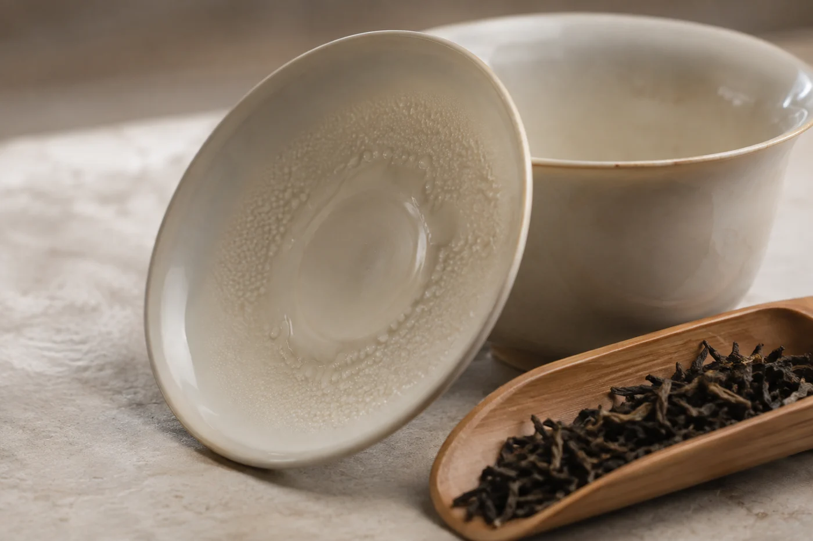

袋口一剪開，鼻子比手先到。

大多數時候，那一下聞到的是熟悉的茶香。偶爾不是。氣味和記憶中不同，人很自然想沖一泡來「驗證」一下。我的做法剛好相反：先停下來，熱水壺放回原位。有疑問的茶，不必拿自己去試。

氣味不對，原因可以有很多。可能只是旁邊放了香料，沾上了味道；也可能和存放環境有關。單憑聞一下，很難立刻下結論。

先要分清，不是所有特別的氣味都代表出了問題。熟普洱剛開袋，常有發酵帶來的特有氣味，這和發霉的味道不同，通常放一陣子就會淡去。焙火較重的烏龍與岩茶，會有焦糖或炭焙的氣息；剛製成的茶，也可能帶一點新茶的青味或火氣。這些都和存放無關。

陳放多年的茶有「陳味」。乾淨的陳味，多帶藥材、木香、棗香一類的氣息；若是悶、酸、霉，就不是了。要分得出，只有多聞幾款正常的茶，慢慢累積自己的比較基準。我早年在雲南喝到一餅真的老茶，才知道所謂陳香是甚麼一回事：不是香，是乾、暖、像舊木櫃打開的那一下。有了這個記憶，之後聞到霉，就分得清。

## 這幾種氣味要提防

潮悶的味道，像潮濕的紙箱、舊衣櫃，或者帶酸味、餿味、泥腥味，都要小心。油耗味、煙味、藥水味、樟腦丸味，多半是吸了外來的氣味。這不一定危險，但代表茶已經受污染，品質大打折扣。

聞完也要看。乾茶上有白色或綠色絨狀的斑點，發黏結塊，茶粉堆積，有細小的孔洞，都是不好的訊號。有些霉只在紙上，餅面反而乾淨，所以包裝紙也要翻過來看，尤其是貼住餅身那一面。

## 停下來之後，逐樣檢查

先看包裝有沒有破損，茶有沒有受潮，再看存放的位置，附近有沒有水氣、清潔劑或其他異味的來源。若見到霉斑、蟲蛀，或者明顯的異常，就不應該沖泡試味。高溫沖煮、洗茶，或者把看起來有問題的葉片挑走，都不能當作安全的保證。

如果只是輕微的異味，沒有霉斑，也沒有受潮的跡象，可以倒出一點，放在乾淨的白碟上，遠離其他氣味，過十來分鐘再聞。外來的氣味常常會散去一些，茶本身的味道會浮上來。這個做法只幫助判斷，不代表可以放心喝。

萬一沖了才覺得不對，入口有明顯的霉味、酸餿或刺喉，就停，把茶湯吐掉，漱口，不要勉強喝完。

「是不是我泡壞了？」

「先別喝。吐掉，漱口。」

葉底也看一看，葉片發黏、有斑點、帶明顯腐味的，不要再用。

身體若有不適，應該找醫生，告訴醫生你喝過甚麼，並保留剩下的茶和包裝。我不能替任何人判斷身體狀況，這件事要交給專業人員。

## 找供應者，帶齊資料

保留商品資料和購買記錄，拍幾張清晰的照片，再聯絡賣家或供應者。描述盡量具體：甚麼時候開封，怎樣保存，氣味甚麼時候出現。這些細節，比一句「茶壞了」更有助問題得到處理。

剛買回來就覺得不對，當天就聯絡對方，拖得愈久，愈難追查原因。自己存放了一段日子的茶，供應者未必能負責，但仍然可以請教，聽聽專業的看法。

有霉變、蟲害、強烈異味的茶，我不建議再作任何飲食用途。如果只是吸了外來氣味、沒有受潮，要不要繼續喝，由自己決定，但不要送給別人。不確定的，寧可丟掉。茶再買就有，不必為它冒險。

同一個位置放着的其他茶，也要逐包看看。如果問題出在環境，只換掉一包茶並不足夠，要先改善受潮、滲水或異味的來源，再替茶找新的存放位置。

平日把存放環境顧好，比出事後補救省心。包裝封好，位置乾爽，遠離異味，大部分問題都可以避免。買茶時選信譽良好的供應者，收到茶之後先檢查包裝是否完好。

珍惜茶，不代表任何情況下都要把它喝完。有疑問的那一包，先放到一邊，拍好照片，寫上日期。
