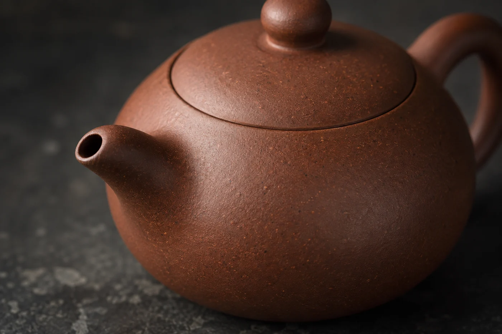
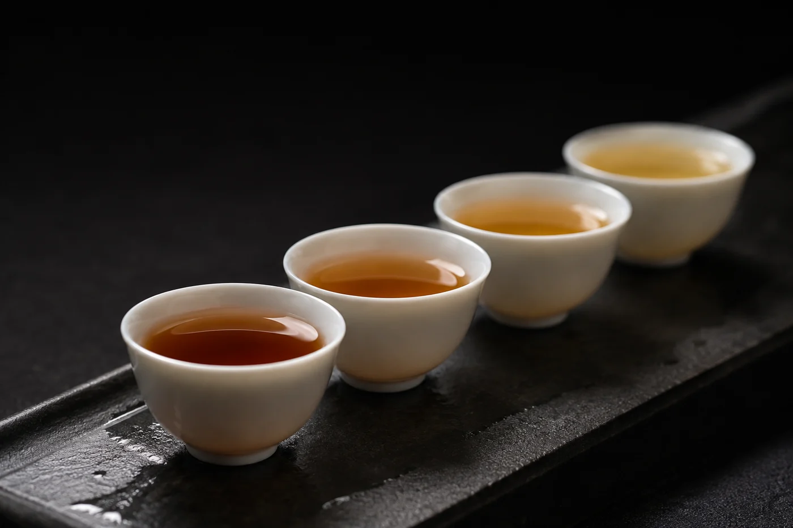

計時器響了。學生拿起蓋碗，對着公道杯停了一下，調好手指，才慢慢開始倒。

他以為自己泡了十秒。可是倒茶又用去十秒，這十秒裏，茶葉一直浸在水中。第一杯和最後一杯，濃度自然不同。初學的人，時間常常耗在手的猶豫裏。

茶葉只要泡在水裏，就在釋出味道。小蓋碗出湯快，也要十來秒才倒得乾；大壺、出水慢的壺，可以更久。一把倒得慢的壺，最後那一杯可能多浸了十幾秒，喝起來明顯較濃。

所以我教人，先讓出水又快又穩，再談計時。出水順了，計時器上那個數字才有意思。

壺嘴有沒有堵，蓋碗的縫會不會太窄，公道杯是不是擺得太遠？器具順手，茶湯倒得穩，比一味求快有用。

壺嘴最常見的毛病，是被茶葉碎屑或茶垢堵住，出水變成一條細流，或者倒完之後壺嘴還在滴。定期用軟毛刷或牙籤，把壺嘴內側的茶渣清一清就好。壺內出水孔有網眼的，也要看看有沒有被葉子貼住。

用蓋碗，蓋與碗之間的縫要留得夠寬，食指同時按住蓋子，免得它滑落。縫太窄，出湯慢；縫太寬，茶葉會跟着湯一起流進公道杯。

## 十秒，由哪一刻算起

計時有兩種算法：一種由開始注水算起，一種等注水完成才算。兩種都有人用，要緊的是自己前後一致，跟別人交流時講清楚。不然大家都說十秒，比較的其實是兩回事。

我習慣由注水完成起算，到開始出湯為止。注水要花幾秒，是固定的成本，自己心裏有數就行。若注水很慢，或分幾次圈注，就更要統一標準。

小器具的好處也在這裏。小壺一泡只有六七十毫升，倒茶幾乎是一個動作，時間上的誤差不大；大壺、大蓋碗倒得久，誤差就明顯。初學的人用小器具較易掌握，道理就是這樣。

茶湯先倒進公道杯，再分到各隻杯，同席的人喝到的濃度就相近。湯在公道杯裏混合，上層下層拉平了，這是公道杯的用處。沒有公道杯，就把杯子排成一列來回地倒，每杯先倒一半，再倒回頭，直到倒滿。

至於每一泡的時間，一泡未必比一泡久。上一泡偏濃，下一泡就縮短停留；頭兩三泡常常用同樣的時間就好，到後段才需要逐步加時。

練出水，用清水就可以。在水槽邊，蓋碗注水到七成，看自己倒乾要幾秒，計三次，取平均。再用同一個速度練一次，看每次相差多少。手穩了，換成茶來沖，就不怕時間在手上溜走。

練得久了，耳朵會聽得出水流由連續變成滴答，那就是茶湯快倒完了。動作要穩，甩壺和猛力搖，只會濺出來。最後那幾滴先不理它，碗口朝下停一兩秒就好。
