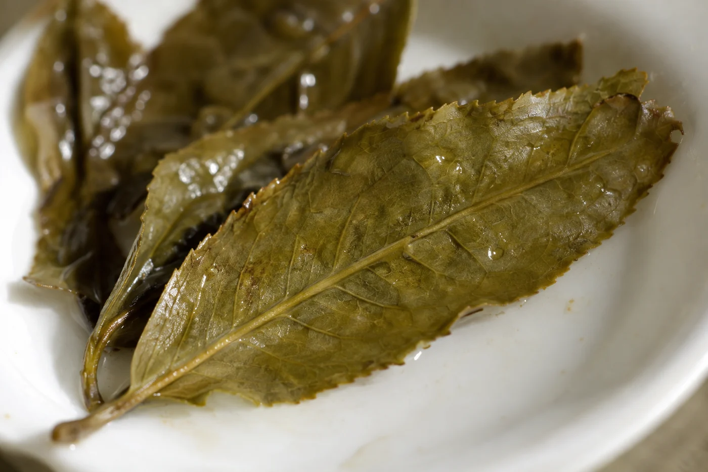

鮮葉剛攤上竹篩，葉面是亮的，葉柄挺着，捏一下會折。

過一段時間再看，光澤暗了一點，葉子垂下來，葉柄軟了，氣味也變了。整個過程沒有翻炒的聲響，也沒有甚麼大動作。

這一步叫萎凋。畫面太安靜，很多人以為只是「放着等」，這正是它常被低估的原因。

萎凋，就是把採下的鮮葉攤開，讓它慢慢失去部分水分，葉子變軟，內含的成分開始轉化。白茶、紅茶和烏龍茶的製作都少不了這一步。後面揉捻、氧化順不順利，最終的香氣如何，它都有直接影響。

鮮葉含水很多，質地脆，一揉就斷。水分逐步散去，葉片柔軟了，後面的加工才好做。這段時間裏，葉內的化學成分也沒有停下來，香氣物質、味道物質都在轉變。萎凋做得好不好，往往在成品的香氣裏聽得出來。

難的是快慢。水分散得太急，葉面乾了，芯還是濕的，轉化就不均勻；散得太慢，葉堆悶着，容易生出不好的氣味。製茶人一直在拿捏的，就是中間那個剛剛好。

## 每種茶要的不一樣

把萎凋當成同一件事，很容易誤會。白茶的萎凋時間長，是整個製作的核心，成品的風格大半在這一步定下。紅茶萎凋之後緊接揉捻和氧化，葉子要先軟，才揉得開。烏龍茶在萎凋之外，還要搖青，讓葉緣輕微受傷，促進香氣形成。

綠茶又是另一回事。一般採下來很快就殺青，中間只有短時間的攤放，習慣叫攤晾，和上面說的萎凋，目的與程度都不同。

萎凋有日曬，也有室內。日曬萎凋借陽光和自然風，失水較快，也帶出日曬的氣息。室內萎凋或加溫萎凋，環境可以控制，天氣不穩的時候較合用。也有先曬一會、再移入室內的，兩者配合。

用哪一種，看茶類和想要的風格，沒有統一答案。日曬太猛，葉會灼傷；室內悶濕，葉會變壞。要緊的是製茶人懂得按天氣和葉的狀態調整。

常聽人說萎凋是「看天做茶」。日光、溫度、濕度、風，都會改變葉片失水的速度。同一批葉，晴天和陰天的處理方式可以完全不同。

所以站在竹篩旁的人，要看的東西很多：葉子鋪得多厚，空氣流不流通，葉面有沒有失去光澤，葉柄軟到哪個程度。有時伸手捏一捏，湊近聞一聞。這些判斷靠經驗一點點累積，很難只用一個時間數字交代。

## 杯裏喝得出多少

喝得出一部分。萎凋不足的茶，常見青草氣偏重，口感生澀；萎凋太過，或過程中悶住了，可能出現濁氣或酸悶。

不過茶的味道受好幾道工序影響，單憑一杯，很難說出是哪一步出了問題。我不會隨便下判斷，有疑問，就請教做茶的人。

有機會到製茶現場，少動手，多觀察。未經同意，不要翻動、觸摸或帶走茶葉，走動時也保持動線整潔。對遊人來說，竹篩上的葉是一個好看的拍照場景；對製茶的人，那是一批正在進行、要專心照顧的原料。

想知道萎凋到甚麼時候才算夠，我會問對方憑甚麼判斷。得到的答案，多半是手感和氣味的描述，比一個數字有意思。

在家裏也可以看一看萎凋是甚麼樣子。若從朋友處取得一把茶青這類新鮮葉子，薄薄攤在竹篩或透氣的盤上，放在陰涼通風處幾小時，看它怎樣由硬挺變柔軟，氣味怎樣改變。這只是觀察，不能當成製茶。
