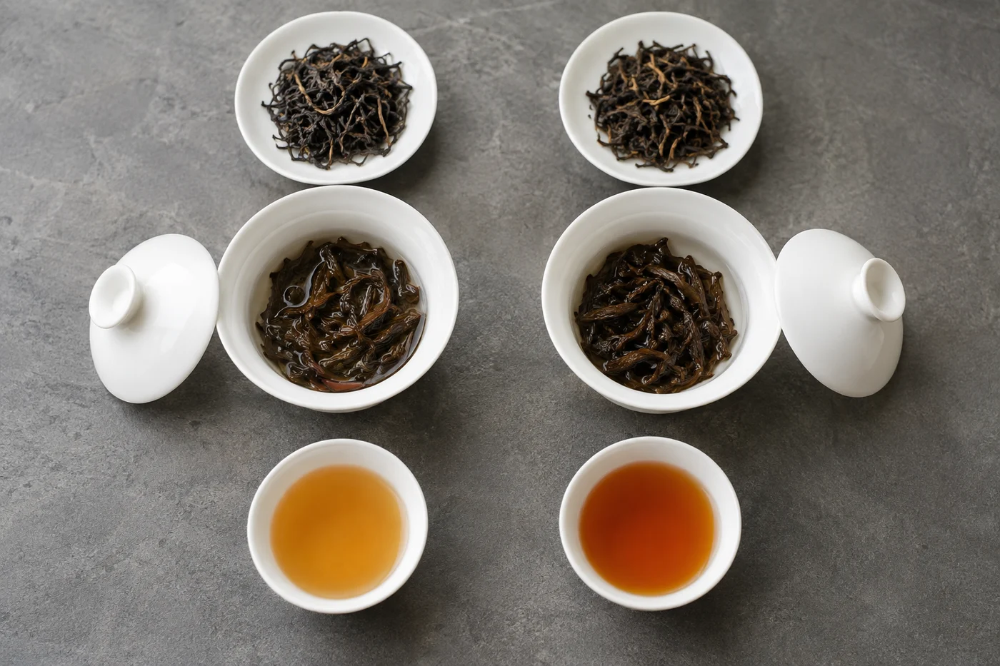

翻開舊筆記，一頁上寫着「香、甜、滑」，下一頁也是「香、甜、滑」。隔了一個月再看，幾款茶長得一模一樣。

當時的感受並不假，只是字眼太寬，容不下那些值得記住的細節。這種筆記我也寫過，後來改了寫法，核心只剩兩部分：沖泡的基本條件，加上兩三項最清楚的感受。條件讓日後能重現，感受讓日後能比較。

評審報告和文采都用不着。一個月後的自己看得懂，就算成功。

茶名、日期、器具、茶量、用水，還有大約的浸泡時間。這幾行像地圖上的座標，缺了它，同一款茶下次泡出不同味道，你就不知道從何追查。

茶量可以用電子磅秤記克數，不方便的話，寫「約三分之一蓋碗」也行，日後自己看得懂就可以。水溫寫個大概就夠，「剛滾」「放涼半分鐘」之類都算記錄。

資料若是從包裝上來的，就照包裝抄，並標明這是包裝上的說法。商家的形容，不要改寫成自己已經證實的判斷。日後回頭看，才分得清哪些是你喝到的，哪些是別人告訴你的。

## 感受只挑最清楚的

感受挑兩三項就好。「第一泡香氣明顯，第三泡開始淡」「入口清，喝完舌面略乾」，這樣的一句，比一長串形容詞有用。

很喜歡一款茶，也寫下喜歡在哪裏，不要只打一個高分。分數只告訴你結果，原因才幫得到你下次選茶。

我自己會跟着喝茶的過程分三段寫：乾茶或揭蓋時的香氣，入口的味道與質感，嚥下之後的餘韻。每一段只寫一兩句。筆記自然有了結構，也提醒自己每一步都停下來留意。

用詞可以參考網站上談香氣、苦澀、質感和回味的幾篇筆記，但最終要用自己真實的感覺，不要為了好看硬套詞彙。

一個好用的做法，是把紙分成兩欄。一邊寫實際喝到的，另一邊寫下次想試的調整，例如少放一點茶，或者縮短第一泡。過幾天再泡，把兩次記錄放在一起看，就知道是哪個改動起了作用。每次只改一樣，結論才可靠。

說得具體一點，一則筆記大概是這樣：第一行寫日期、茶名、蓋碗、茶量約幾克、水量與水溫、第一泡時間。下面兩行，一行寫香氣是甚麼方向、強弱如何；一行寫入口的質感和味道，尾段怎樣。最後一行寫下次想試的，例如「第二泡縮短時間」。

整則筆記不用超過五六行。覺得太簡單，就讓它短。下次沖同一款茶時再補幾句，那時它才真正派上用場。

偶爾翻舊筆記，會發覺自己的看法變了。從前寫「太濃」的茶，現在可能覺得剛好。這並不丟臉，筆記有用，正是因為看得見這種變化。

## 紙本或手機都可以

紙本會沾上茶漬，有一份紀念感；手機方便搜尋，可以附照片。兩樣都行，要緊的是選一種你能持續用下去的。

喝茶時不方便寫，可以先用手機錄一句話，或者拍下茶湯與葉底，稍後再補字。照片裏有杯子、有湯色，加上日期，日後已能喚起不少記憶。

筆記要放在同一個地方，一個固定的本子，或一個固定的資料夾，不要散落各處。每款茶一頁或一段，新的記錄加在舊的下面，就能連着看出變化。

記錄不該把喝茶變成負擔。有時只寫三行，也比不寫強。
