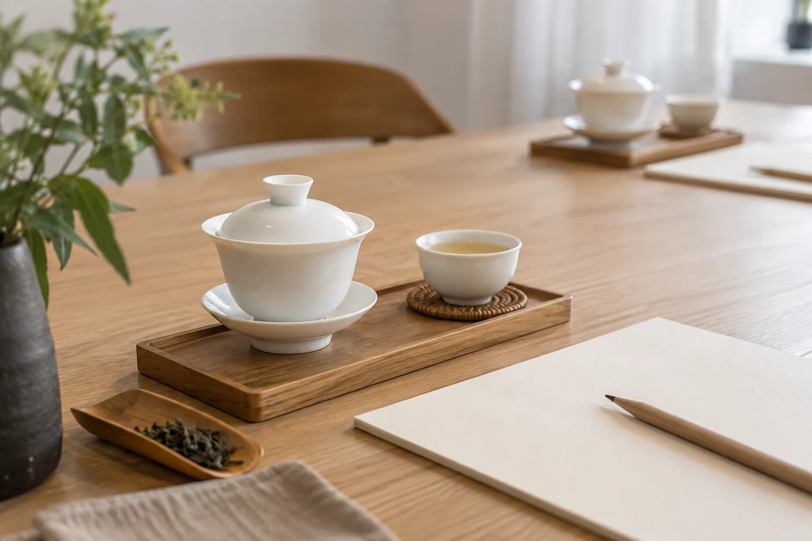

課室裏，茶盤旁邊放着一枝喝了一半的樽裝檸檬茶。

我沒有叫人收起它。那天的第一道題，就從它開始：樽裝茶和現泡的茶，有甚麼不同？

想讓年輕人接觸茶，我發覺先拋一個貼身的問題，比先講傳統有多重要管用得多。一開口就說這是珍貴的文化，聽的人多半只會點頭。換成「為甚麼同一包茶，可以泡出兩種味道」，他們反而願意坐近一點看。

我會先請大家說說平日怎樣碰到茶：奶茶、檸檬茶、樽裝茶、手搖茶飲、家裏的茶壺，或者在社交媒體看過的沖泡片段。這些經驗不需要先被糾正，它們連得到工藝、風味和生活，是很好的入口。

港式奶茶用的是紅茶，檸檬茶也是紅茶加檸檬；手搖茶飲的茶底，多是綠茶、紅茶或烏龍。由這些熟悉的味道出發，再問一句「茶葉本身是甚麼味道」，下一步就很自然。

## 兩隻杯，就是一個試驗

兩隻相同的杯，同一款茶，浸泡時間不同。條件清楚交代，讓大家自己看、自己說。這麼簡單的對照，已經引出很多問題：為甚麼泡久了變苦？為甚麼第二泡比第一泡淡？

冷泡和熱泡也可以對照。同一款茶，一份用熱水沖，一份放進冷水浸一段時間，再比苦澀和香氣。年輕人通常對冷泡有興趣，方便，在辦公室或課室也做得到，溫度怎樣影響味道，一喝就看得出。

平日不習慣喝茶的人，也可以從看器物、看葉片參與。聽和看同樣是認識茶的方法，不必要求每個人都說得出「這是回甘」。

有人喜歡加奶，有人喜歡純茶，有人愛冷飲，都可以。討論時容許喜好不同，別以傳統之名，要所有人接受同一種喝法。資料要準確，說法可以貼近現在的生活。

我給自己的態度是：把茶的知識說清楚，把選擇留給對方。對方若覺得悶，多半是我講的東西離他們太遠，不是他們不懂欣賞。

## 讓他們動手，也讓他們說

活動裏，我會請參與者整理一張茶卡，寫上茶的名稱、乾茶的樣子、泡出來的味道，加一句個人感受；或者拍一張葉底的照片，配兩句描述。這既是練習理解，也是練習分享。他們慣用的表達方式，直接用就好。

對象是中學生的話，可以請他們帶一款自己平日喝的茶，把標籤上的資料讀出來，茶類、產地、沖泡建議，再問「這樣寫是甚麼意思」。讀標籤本身就是一課，日後自己買茶也用得着。

年長一輩也可以一起來。最好的方式，是請他們講自己熟悉的茶，平日喝甚麼，家裏怎樣泡。這是年輕人最容易碰到的活材料。長輩講，年輕人問，各說各的經驗，不必爭誰對誰錯。

年輕人肯把問題帶回日常，文化就有地方繼續長。下次和他們泡茶，我還是會先問：你平日最常喝哪一種？
