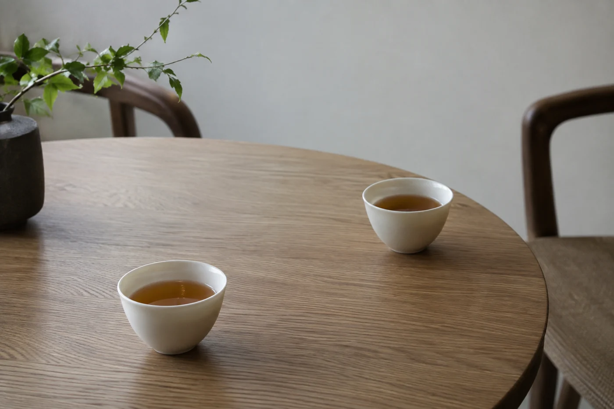

壺蓋斜斜架在壺口，不用開口，伙計已經提着水壺走過來。

這個動作，很多香港人從小看到大，熟得不會多想。說「去飲茶」，我們想到的也不單是一杯茶，還有一張桌、幾籠點心，和終於有時間坐在一起的人。茶壺在桌上來回，話題跟着杯子慢慢轉。正因為太熟悉，這種日常很容易被忽略。

「一盅兩件」，指一壺茶加兩款點心，是香港人形容茶樓小坐的說法。盅是盛茶的壺或蓋盅，兩件則泛指小食，不一定剛好是兩件。早年的茶樓，點心車推着走，一籠一籠冒着煙，客人招手就停。現在的茶樓多數把點心和茶分開計，這句話卻留了下來，成了閒適的代稱。

茶單上常見的有普洱、鐵觀音、壽眉、香片（茉莉花茶）、菊花，各家店有自己的選擇。很多人會叫一壺菊花和普洱混着泡，行內叫「菊普」，清熱的說法各有各講，味道確實清爽些。也有人每次都只喝同一款，伙計一見他坐下，就自動端對的壺過來。

茶在這裏有兩個作用：陪點心，也讓人坐得久一點。所以茶樓的茶多數沖得較濃、較耐泡，加幾次水，味道依然站得住。這和細品名茶是兩種取向，拿來比高下就沒意思，各有位置。行內說「水滾茶靚」，一壺不夠熱的茶，在茶樓是留不住的。

## 斟茶、叩手指、掀蓋

這幾樣是香港人熟悉的習慣，各有說法。

替人斟茶，先斟長輩或客人，最後才到自己。對方用食指和中指輕叩桌面表示謝意，這做法流傳很廣，一般認為與感謝斟茶有關，來歷眾說紛紜，我只當作一份心意。

壺裏的水喝光了，把壺蓋掀開，或者斜放在壺口，是向店員示意添水的常見做法。不過各家店習慣略有不同，不清楚的時候，直接跟店員說一聲，最不容易出錯。有些老伙計看見蓋子歪了半寸就懂，有些新店根本沒有這個默契。

## 點心的輕重，配茶的濃淡

我自己的配法很簡單，按茶的濃淡配點心的輕重。蝦餃、腸粉這類清淡的，配香片或淡一點的茶，不會蓋過味道。燒賣、叉燒包、炸的點心油脂重，配普洱或鐵觀音這類濃一些的茶，喝起來有清口的感覺。多數人都這樣配，但這不是定律。

到了蛋撻、馬拉糕這些甜點，我多數換一壺清淡些的茶，或先喝點白開水再續茶。口腔被甜味膩住，茶味反而顯得淡。這一點我試過好幾次，甜點之後那一口濃普洱，忽然變得又苦又薄，不是我喜歡的味道，等一會再喝，茶又回來了。

## 在家也可以飲茶

在家裏也成。週末早上泡一壺普洱或香片，買幾件喜歡的點心擺上桌，已經有那種氣氛。用蓋碗或茶壺泡，用公道杯分茶，讓每個人都喝到熱茶。燙的壺和杯要先放穩，家裏有小孩和長輩，記得提醒一句。

誰習慣先替長輩斟茶，誰總記得加水，誰一坐下就知道家人喝甚麼茶，這些都是相處累積出來的。

下次去茶樓，點心上桌之前，可以先喝一口，留意茶名、香氣和濃淡，續水之後再喝一口，看看有甚麼變化。別把家庭聚餐變成評審會，只是替本來熟悉的事多留一分注意。

也可以問問家人，從前喜歡去哪裏飲茶，那時常點甚麼、喝甚麼。不同年代、不同家庭的記憶未必一樣，我喜歡聽完整，不想用一個故事概括整個城市。有人講起小時候在茶樓樓梯口等位，有人記得的是那張轉盤桌上的報紙。這些細節比「以前的茶樓很有風味」實在得多。

茶樓裏最熱鬧的時候，茶壺反而最靜。它一直在那裏，只是很少人記得問它一句。
