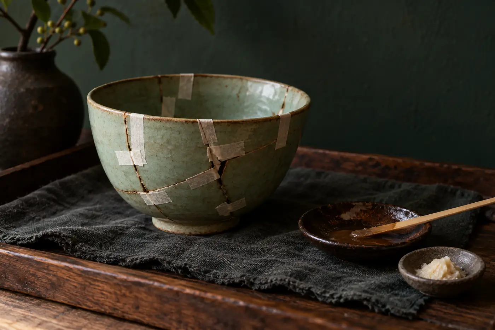
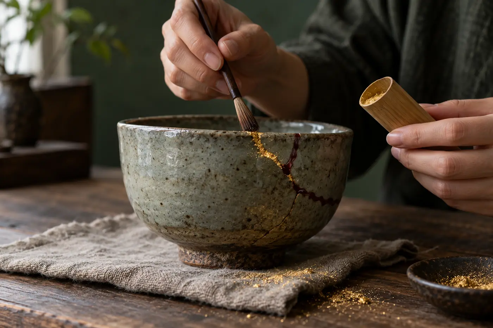

同學把一隻杯推到我面前，杯身一條金線，由口沿斜斜落到杯腹。

「這條是不是用金色膠水塗上去的？」

我請她用手指摸一摸那條線。她順着摸下去，指尖在轉角停了一停，說摸得到，高了一線。

線比釉面略高，邊緣有點不齊，像一小段乾了的河牀。金色只是最後看到的那一層，底下的東西看不見，所以才容易誤會。網上也有人賣修補套裝，說一個下午就能完成，看得多了，難免以為修杯就是「黏好，再塗金」。

[[金繕]]在日本寫作「金継ぎ」，中文也常寫成[[金繼]]，意思都是以金修補、以金承接。傳統做法用的是天然漆：接合、填補、上漆、打磨，一步一步做好之後，才在表面施金。看起來是一道金線，下面是好幾層漆。這種用漆修補陶瓷的做法，在中國、韓國和越南的器物上也見得到，並非日本獨有，只是日本的金繕最為人熟知。

## 一道金線下面有甚麼

傳統金繕的主角是漆。[[生漆]]是漆樹的樹液，漆樹主要生長在中國、韓國和日本一帶。生漆要調成不同的漆料，才能做不同的工作。

第一步是接合。常見的做法是用[[麥漆]]，由生漆加麵粉和水搓揉而成，塗在斷口上，把碎片合回原位。接好之後，裂縫和細小的缺口通常不會剛好平整，這時要用[[錆漆]]填補。錆漆是生漆混合砥粉和水調成的膏，用來把凹位填平。

我第一次試調麥漆，麵粉下得急，糊太稠，抹上斷口拖不動，最後要颳掉重來。師傅在旁邊看着，只說麵粉要一點一點加。

填好以後，表面先上一層黑漆或紅色的弁柄漆，硬了再磨，磨平再上一層。這樣反覆幾次，接縫才會順滑。到最後一層薄薄的漆還未乾的時候，才把[[金粉]]撒上去，讓金附在漆面，等漆硬了，再把多餘的金粉抹走。

所以把碎片接起來的是漆，金是蓋在最外面的一層。施金時除了金粉，也有人用銀粉；有些工作坊為了減低成本，會改用黃銅粉一類金屬粉，顏色相近，價錢便宜很多，日後的變化卻不一樣，這些分別可以看看[啞的還是亮的](/repair/is-it-real-gold/)那一篇。

## 為甚麼要等那麼久

「我這隻杯補了多久？」她把杯留在桌上，手縮回去。

「別人補的，我不知道。自己動手，起碼個把月。」

很多茶友聽到修一隻杯要等上幾個星期，都會嚇一跳。原因在漆的性質。天然漆和一般膠水不同，它要在濕度高、溫度適中的環境裏才會變硬，這個過程叫[[固化]]。所以做金繕的人會準備一個[[漆室]]，可以是一個木櫃或箱子，裏面保持潮濕，讓每一層漆在裏面硬化。Tsugu Tsugu 的介紹提到，漆要硬化，濕度大約要在七成至八成多，溫度在二十至三十度之間。

Chimahaga 列出的時間大致是：接合之後等約一星期，填補和每次上漆之後各等數天，最後施金之後再等約一星期。一件破了的器物要全部做完，Chimahaga 的說法是最多約一個月。另一家金繕工房 Tsugu Tsugu 的經驗則是兩三個月相當常見，視乎破損的情況。完成之後，漆要由表面硬到裏面，還需要一段日子，所以 Tsugu Tsugu 建議修好之後至少放一個月才開始使用。

這也是我常跟同學說的：金繕急不來。如果有人說幾天就能交回一隻「金繕」杯，先問清楚用的是甚麼材料。等的時間縮短了，多半是材料換了。

## 漆會咬人，也有替代做法

生漆有一點要先講清楚：它會令皮膚敏感。漆樹與毒葛同屬一科，未乾的漆碰到皮膚，不少人會紅腫痕癢，敏感的人連喉嚨也會不適。所以做金繕要戴手套、遮好手臂。麻煩主要在製作過程，杯子修好、漆完全乾透之後，Chimahaga 的說法是一般很少再引起敏感。

「那我學得來嗎？」她問。

「學得來。先看你的手受不受得住漆。」

想自己學的茶友，先了解自己對漆的反應，再決定報不報班，會穩妥一些。

市面上的「簡易金繕」或「現代金繕」，多數用環氧樹脂一類合成膠代替漆，再配金屬粉，一天至十天左右就能完成。看起來也是一道金線，材料卻完全不同。有些合成膠標明固化後可接觸食物，很多卻沒有，用來盛茶之前要先看清產品說明。修過的杯能不能盛熱茶，要分材料和泡法來談，詳情可以看[先倒進公道杯](/repair/hot-tea-in-repaired-cups/)。

用漆修補以外，還有一種用金屬釘跨過裂縫、把碎片扣緊的方法，中國民間叫[鋦瓷](/repair/staple-repair/)。兩種方法看起來很不一樣，各有適合的器物。茶友聽到別人說「補過」，多問一句是怎樣補，用漆、用膠還是用釘，照顧方法都不同。

## 金繕與茶桌

金繕與日本茶道的關係很深，一般認為它是隨着茶人珍惜茶碗而流行起來的。美國史密森尼亞國家亞洲藝術博物館藏有十七世紀的日本茶碗，碎了之後用漆接合，在漆上撒金粉修好，今天仍看得見那一道道金線。至於金繕最早由誰開始，說法不一，坊間流傳的故事不少，聽聽就好。日本抹茶的源流，可以參考[日本「抹茶道」的始祖](/journal/diancha-and-matcha/)一篇。

我喜歡金繕，理由很實在：一隻常用的杯摔破了，還有辦法讓它回到茶桌上。白瓷杯上的金線特別顯眼，選白瓷的道理，[品茶必備白瓷茶具](/journal/white-porcelain-for-tasting-tea/)一篇有談到。修好的杯要花時間等，用的時候也要多一分細心，這份耐性和泡茶相通，可以對照[飲茶是一場修行](/journal/tea-as-a-daily-practice/)來讀。

常有人問，金繕可不可以自己在家做？可以學，但要有心理準備：生漆會令皮膚敏感，要有地方放漆室，每一層又要等。先跟有經驗的導師上幾堂課，認識材料和保護方法，再決定要不要自己動手。

「我走了。」她拿起杯，走到門口又回頭，「我怎麼知道它用甚麼補？」

「買的時候請人把補法寫在盒底。」

她點了點頭，說下次會記得，就走了。
